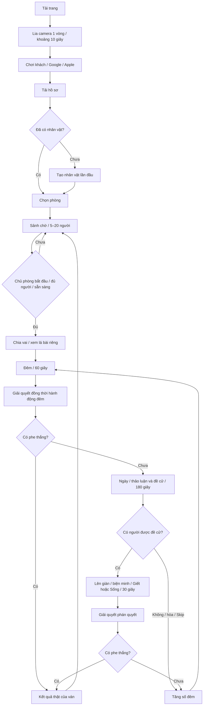

# Huyết Nguyệt Thôn — Spec luồng chơi chính

Ngày rà soát: 31/10/2026. Nguồn đối chiếu: mã trong workspace hiện tại, không phải bản đã triển khai.

## 1. Cách đọc và phạm vi

Tài liệu này là hợp đồng hành vi của luồng chơi chính. Các mục 2–12 mô tả chuẩn cần đạt; mục 13 ghi rõ khác biệt đang tồn tại trong mã. Không được coi một hành vi sai ở mục 13 là luật chơi đã được chấp thuận.

- **Đã có**: có đường đi thực thi trong mã; không đồng nghĩa đã kiểm thử trên thiết bị thật.
- **Cần sửa**: mã chưa đáp ứng chuẩn hoặc có mâu thuẫn giữa UI, server và luật.
- **Cần chốt**: quyết định sản phẩm chưa được người sở hữu xác nhận; không tự thay đổi luật khi triển khai.
- Phạm vi: tài khoản, nhân vật, phòng, vai trò, đêm, ngày, xét xử, chết, thắng/thua, chơi lại, kết nối và quyền dữ liệu.
- Ngoài phạm vi: xếp hạng, thanh toán, matchmaking công khai, cửa hàng, yêu cầu kết bạn hai chiều.

Server là nguồn quyết định duy nhất cho pha, thời hạn, quyền hành động, phiếu bầu, kết quả và thắng/thua. Client hiển thị và gửi ý định; camera, âm thanh hoặc đóng modal không được tự kết thúc một pha.

### Cập nhật chuyển pha và quyền phòng

- Đủ chức năng đêm hoặc hết giờ: khóa lựa chọn, đếm ngược 5 giây, nội suy ánh sáng đêm → ngày rồi mới tổng kết đêm.
- Đủ phiếu ngày hoặc hết giờ: có bị cáo thì vào 30 giây biện minh, camera focus bị cáo và ánh sáng ngày → hoàng hôn. Không có bị cáo thì khóa phiếu, đếm 5 giây ngày → đêm.
- Đủ phiếu Giết/Sống hoặc hết biện minh: khóa phiếu, đếm 5 giây hoàng hôn → đêm rồi tổng kết phiên xử. RPC chốt tay không còn hiệu lực. Reset hủy countdown đang chờ.
- Chủ phòng được sửa bộ bài/số chỗ, thêm/bớt AI, kick và chuyển quyền trong lobby. Người khác chỉ xem bộ bài, kể cả chi tiết lá bài. Server kiểm tra quyền, không chỉ vô hiệu hóa nút.
- Capacity 5–20; số thành viên thực tế có thể dưới 5 vì kick/rời phòng. Chỉ bắt đầu khi số người bằng số chỗ và tất cả sẵn sàng. Người thật hoặc AI vượt cấu hình hiện tại tự nâng capacity lên bằng số người, không quá 20.
- Khi hết ván/về lobby, popup và chat ẩn thông báo hệ thống; reset loại thông báo hệ thống ván cũ. Dọn trò chuyện chỉ ẩn lịch sử trên máy người bấm; tin mới tiếp tục hiện.
- Chọn nhân vật dùng proxy sát thân và bảng tên; nhân vật local không chặn việc chọn người khác.
- Cài đặt có slider nhạc/hiệu ứng 0–100%, lưu trên máy và giữ qua tải lại. Nhạc nền dùng mức theo pha nhân với slider; mọi hiệu ứng đi qua master gain chung. Nút tắt/bật giữ mức slider; giọng nói không bị slider này thay đổi.

## 2. Sơ đồ tổng thể



Các pha khai báo nhưng chưa có luồng đầy đủ: `day_announcement`, `hunter_revenge`. Không đưa chúng vào sơ đồ như tính năng đã hoàn tất. `day_voting` hiện là phần tiếp diễn của cùng lượt ban ngày, không có thêm 180 giây riêng.

## 3. Tài khoản và nhân vật

1. Mỗi lần tải trang chạy intro một lần. Về màn hình đầu trong cùng phiên không chạy lại. `autostart=1` là đường đi kiểm thử, bỏ qua intro và chọn tài khoản.
2. Màn hình tài khoản riêng xuất hiện trước màn hình nhân vật/phòng. Người chơi chọn Chơi khách, Google hoặc Apple; người đã đăng nhập có thể tiếp tục.
3. Chơi khách dùng phiên Supabase ẩn danh nếu có cấu hình, đồng thời giữ bản lưu trình duyệt. Không dùng IP để nhận diện tài khoản.
4. Google/Apple dùng OAuth qua Supabase. Liên kết phiên khách phải giữ cùng `auth.users.id`. Đăng nhập tài khoản đã có ưu tiên tải hồ sơ của tài khoản, không ghi đè bằng nhân vật khách cũ.
5. Google/Apple cần bật provider, cấu hình callback/redirect và manual identity linking ở Dashboard. Có nút trong UI chưa có nghĩa provider đã hoạt động.
6. Chỉ tạo nhân vật lần đầu. Hồ sơ tồn tại thì đi đến chọn phòng; vẫn có thao tác Sửa nhân vật. Tên tối đa 24 ký tự; danh hiệu Cổ Thôn đang ẩn, dữ liệu cũ được giữ.
7. Lỗi đồng bộ không được làm mất hồ sơ cục bộ. Những thay đổi chưa đồng bộ cần được thử lại; UI báo trạng thái phù hợp.
8. Đăng nhập thất bại hoặc bị hủy quay lại lựa chọn tài khoản, không tự vào phòng.

Hiện room/game ID và Supabase Auth ID là hai hệ nhận diện khác nhau; xem lỗi P0 ở mục 13. Danh sách bạn bè hiện là danh bạ do người dùng lưu, có link phòng, không phải quan hệ bạn bè được đối phương chấp nhận hay dữ liệu online thật.

## 4. Phòng và sảnh chờ

### 4.1 Vào phòng

- Tạo phòng mới hoặc nhập mã/link `?room=...`.
- Phòng mới chỉ có người tạo, không tự sinh AI. Thay đổi số chỗ không tự thêm AI.
- Giới hạn tuyệt đối 20 người/slot trong phòng; không chèn người thứ 21 qua join, thêm AI hoặc đổi số chỗ.
- Số chỗ là sức chứa, không phải số bắt buộc phải lấp đầy trước khi bắt đầu. Không giảm sức chứa xuống dưới số người đang có.
- Người vào lại cùng danh tính chiếm lại slot của mình, không tạo bản sao.
- Chuẩn cần đạt: người mới vào giữa ván chỉ được chờ/quan sát, không được thêm vai trò hay tham gia bỏ phiếu vào ván đã chia bài. Mã hiện tại chưa bảo đảm điều này.

### 4.2 Chủ phòng và sẵn sàng

- Người tạo/ người đầu tiên là chủ phòng; bảng tên có vương miện, cập nhật khi chuyển quyền.
- Chỉ chủ phòng được bắt đầu, chỉnh sức chứa, AI, bộ bài, mời người rời phòng, chuyển chủ phòng và đặt lại ván.
- Bắt đầu khi số thành viên bằng chính xác số chỗ đã cấu hình (5–20), mọi người ngoài chủ phòng đã sẵn sàng. Chủ phòng được tính là sẵn sàng.
- UI khóa nút khi không đạt; server kiểm tra lại. Không chỉ dựa vào nút disabled.
- AI chỉ thêm bằng thao tác rõ ràng của chủ phòng. AI thủ công hiện được tính là slot và sẵn sàng; muốn yêu cầu 5 người thật là một quyết định khác, chưa được áp dụng.
- Về sảnh sau ván phải có lại trạng thái lobby: người sống, vai chưa chia, chưa có kết quả thắng, phiếu và hành động cũ không còn tác dụng.

### 4.3 Điều khiển và menu

- Sảnh cho phép đi lại, nhảy, chạm/đá cầu lửa; trong ván đứng theo vị trí nghi lễ.
- Trong ván, bên trái thanh trên là ngày/đêm và đồng hồ. Bên phải gom số người, bộ bài role, mời bạn và cài đặt. Không có nút bài cá nhân ở sảnh. Khi vào ván, lá bài role của mình xuất hiện bên trái ngay dưới thanh trên; bấm để mở thông tin, không chồng lên cụm tương tác người chơi. Bắt đầu/Sẵn sàng nằm ở phần trống bên trái cụm công cụ trong sảnh.
- Nút Mời mở danh bạ và Gửi link. Chia sẻ hệ thống nếu hỗ trợ, không thì sao chép; link localhost không dùng được trên máy khác qua Internet.
- Không tương tác kết bạn/thả tim/ném đá chính mình. Không cấm chọn mình làm mục tiêu chức năng hợp lệ như tự bảo vệ.

## 5. Chia vai và xem bài

1. Server chốt người tham gia, tạo đúng số lá, xáo bài, gán vai và đưa vào `role_reveal`, đêm số 1.
2. Mỗi người chỉ nhận lá của mình và thông tin đồng đội được phép biết. Việc giấu bằng CSS không thay thế lọc dữ liệu server.
3. Modal có hai mặt, thao tác lật không bị rê chuột làm giật; âm thanh không phát chồng.
4. Chuẩn cần đạt: mỗi người xác nhận đã xem; không để một người đóng bài làm mất cơ hội xem của tất cả người khác. Cần cơ chế xác nhận riêng hoặc giữ modal cá nhân khi phòng đổi pha.
5. Bắt đầu đêm do server. `role_reveal` hiện chưa có timeout và một `game:enter-night` đã chuyển cả phòng; đây là chỗ cần sửa, không phải barrier xác nhận đã hoàn chỉnh.
6. Chọn vai ưu tiên hiện tồn tại trong công cụ bộ bài. Đây là hỗ trợ thử nghiệm, cần tách khỏi ván công bằng trước phát hành.

## 6. Ban đêm — 60 giây

### 6.1 Quyền và trạng thái

- Chỉ người còn sống có chức năng của đêm hiện tại mới phải hành động.
- UI phân biệt Chọn mục tiêu → Xác nhận → Đã xác nhận, chờ người khác. Có Bỏ qua cho người có chức năng; vai không có chức năng chỉ chờ.
- Mỗi người được chốt một hành động hoặc Bỏ qua mỗi đêm. Server giữ `actedPlayerIds` theo người; không suy ra cả nhóm đã xong từ một mục tiêu chung.
- Sau khi server xác nhận, không sửa/gửi lại hành động. Dữ liệu hoàn tất cá nhân phải trở lại đúng sau reconnect.
- Tất cả người có chức năng đã hoàn tất: server giải quyết sau khoảng 1,2 giây. Hết thời hạn: giải quyết những lựa chọn hợp lệ đã có; không bịa lựa chọn cho người thật chưa làm.
- Không có nút Qua Đêm và không có đường RPC bỏ qua việc chờ người khác.
- Server dùng thời hạn tuyệt đối; client chỉ vẽ đồng hồ. Tick server hiện là 1 giây, nên chuyển pha có thể trễ dưới khoảng một tick cộng độ trễ mạng.

### 6.2 Chức năng theo vai

| Vai | Lựa chọn ban đêm | Giới hạn/ghi chú |
|---|---|---|
| Ma Sói | Chọn con mồi cho bầy | Mỗi sói có phiếu; bầy chọn mục tiêu nhiều phiếu nhất |
| Sói Đầu Đàn | Săn hoặc nguyền | Lượt nguyền dùng chung trạng thái một lần/ ván |
| Sói Trắng | Săn cùng bầy hoặc giết sói khác | Một hành động/đêm theo luồng hiện tại |
| Bán Sói | Không quyết định chủ động | Chưa bị cắn thì không thuộc `isWolfPackRole`; bị cắn hợp lệ đổi thành werewolf |
| Tiên Tri | Soi một người | Kết quả riêng người soi |
| Tiên Tri Hào Quang | Soi hào quang | Chỉ thông tin theo chức năng, không trả toàn bộ role cho người không có quyền |
| Bảo Vệ | Chọn người bảo vệ | Không bảo vệ cùng mục tiêu hai đêm liên tiếp; có thể tự chọn |
| Phù Thủy | Cứu hoặc độc hoặc bỏ qua | Bình cứu/độc mỗi loại một lần/ ván; không hồi lại mỗi đêm |
| Thợ Săn | Chọn trước mục tiêu báo thù | Lưu riêng từng người, dùng khi chết trong đêm hoặc bị xử ban ngày; giải quyết cả chuỗi báo thù/người tình |
| Thần Tình Ái | Chọn hai người khác nhau | Chỉ đêm 1 và khi chưa có cặp; cả hai còn sống |
| Cô Bé | Rình hoặc bỏ qua | Kết quả rình là riêng tư; thuật toán manh mối cần chốt |
| Già Làng | Không quyết định chủ động | Chặn nhát cắn đầu tiên; không chặn độc/xử tử |
| Thị Trưởng | Không quyết định chủ động | Phiếu ngày/phán quyết có trọng số 2 |
| Thằng Ngố | Không quyết định chủ động | Thắng riêng khi bị xử tử bởi dân làng |
| Dân Làng | Không quyết định chủ động | Chờ ban ngày |

Phù Thủy hiện chọn cứu **hoặc** độc rồi khóa hành động theo yêu cầu xác nhận một lần. Nếu muốn dùng cả hai trong cùng đêm cần bổ sung bước chốt cuối; chưa được tự coi là luật mới.

### 6.3 Thứ tự giải quyết đêm hiện tại

1. Gắn cặp Tình Ái hợp lệ.
2. Xác định mục tiêu Bảo Vệ hợp lệ.
3. Tổng kết phiếu bầy Sói.
4. Xác định kết quả soi.
5. Với nạn nhân bị Sói chọn: Bảo Vệ → chuyển hóa Bán Sói → nguyền Đầu Đàn → khiên Già Làng → bình cứu Phù Thủy → chết nếu không được chặn.
6. Áp dụng độc và đòn Sói Trắng.
7. Kéo theo người tình khi một người chết.
8. Áp dụng mục tiêu báo thù Thợ Săn; kiểm tra lại người tình sau phát bắn.
9. Cập nhật trạng thái, vật phẩm, thông báo chết; kiểm tra thắng/thua. Nếu còn tiếp tục, sang ngày cùng số thứ tự.

Hòa phiếu bầy Sói hiện lấy mục tiêu đứng trước trong thứ tự duyệt; chưa có luật hòa chính thức. Đây là quyết định cần chốt, không mô tả thành chọn ngẫu nhiên.

## 7. Ban ngày và đề cử — 180 giây

- Người sống thảo luận và bỏ phiếu một người sống hoặc Skip. Phiếu trước có thể được thay trong thời gian còn lại theo mã hiện tại.
- Thị Trưởng có trọng số 2. Người chết không có thanh Vote/Skip, không gửi được phiếu hợp lệ lên server.
- Phiếu đầu tiên đổi `day_discussion` thành `day_voting`; giữ nguyên `phaseEndsAt`, không cấp thêm 180 giây.
- Tất cả người sống đã có phiếu: server tổng kết sau khoảng 0,9 giây. Nếu chưa đủ phiếu, chờ tới hết giờ.
- Tổng kết theo số phiếu có trọng số cao nhất duy nhất (plurality), không đòi hơn một nửa cả làng.
- Skip cao nhất, hòa cao nhất hoặc không có phiếu: không ai lên giàn; tăng số đêm, bắt đầu đêm kế.
- Một người có số phiếu cao nhất duy nhất: gán `accusedPlayerId`, sang `day_trial`.
- Không có nút Chốt phiếu chung cho mọi người.

## 8. Lên giàn, biện minh và phán quyết — 30 giây

1. Chỉ khi có bị cáo hợp lệ mới hiện giàn treo cổ và đưa nhân vật đó lên giàn.
2. Bị cáo có thời gian biện minh và không tự bỏ phiếu Giết/Sống cho mình.
3. Người sống còn lại chọn Giết hoặc Sống; Thị Trưởng có trọng số 2. Người chết không có quyền vote.
4. Tất cả người có quyền đã vote: tổng kết sau khoảng 1 giây; nếu chưa đủ thì hết 30 giây tổng kết phiếu đã có.
5. `Giết > Sống`: bị cáo chết. Bằng nhau, 0–0, hoặc Sống nhiều hơn: tha bổng.
6. Người tình của bị cáo chết theo nếu còn sống. Thằng Ngố bị xử tử thắng riêng ngay.
7. Hiệu ứng tử hình giữ giàn khoảng 3,5 giây, rồi ẩn; tha bổng thì kết thúc xét xử và ẩn giàn.
8. Sau kết quả, kiểm tra thắng/thua; nếu chưa kết thúc tăng số đêm và vào đêm tiếp theo.

Nút/RPC Phán quyết thủ công vẫn còn trong mã và cho phép kết thúc sớm; cần bỏ hoặc giới hạn vào công cụ thử nghiệm trước khi đáp ứng chuẩn tự chuyển pha.

## 9. Chết, camera, chat và voice

- Mỗi chuyển đổi sống → chết tạo đúng một thông báo hệ thống trong chat; nội dung thông báo chết mới không nêu vai trò.
- Camera lần lượt focus người vừa chết, mỗi người khoảng 3,5 giây, rồi quay lại góc người chơi. Không replay người đã chết từ trước khi reconnect.
- Nếu ván kết thúc cùng lúc, chờ chuỗi focus trước khi mở kết quả; khi đã reset sảnh phải hủy lịch mở kết quả cũ.
- Người chết vẫn xem ván, nhưng không hành động, bỏ phiếu, gửi chat hoặc truyền voice. Mã hiện tại cũng không cho người chết nhận voice.
- Voice ban ngày: người sống nói/nghe người sống. Voice ban đêm: chỉ bầy Sói sống được nghe nhau. Voice Sói không phụ thuộc khoảng cách.
- Text ban đêm: tin Sói vào kênh wolves, không gửi cho người ngoài. Hiện người sống không phải Sói vẫn có thể gửi text global; cần chốt có cho nói đêm hay không. Không tự áp luật voice sang text.
- Nhật ký đang chứa nhiều thông tin vai trò; chính sách công khai vai trò người chết phải được chốt và lọc đồng nhất, không chỉ sửa một dòng thông báo.

### Camera và hiệu ứng nhận diện

- Góc mặc định theo sát nhân vật mình; vuốt giữ góc mới và hướng di chuyển tương đối camera.
- Nút ngón tay chỉ chỉ hiện trong ván: bật giữ tay chỉ ở góc thứ nhất, tắt về thứ ba. Nút toàn cảnh riêng và có thể trở lại góc trước.
- Chỉ thấy vòng dưới chân mình, không có hào quang vàng cá nhân.
- Chủ phòng có vương miện trong bảng tên, không phụ thuộc trang phục.
- Viền đỏ đồng đội chỉ hiện cho Sói sống vào ban đêm, trên Sói đồng đội còn sống, không trên chính mình. Không dùng viền để lộ phe Dân Làng hay vai trò cho người ngoài.
- Ánh sáng mặc định khi tải map/vào sảnh là ban ngày. Trong ván tự động theo pha; tùy chọn đổi ánh sáng chỉ dùng ở sảnh.

## 10. Điều kiện kết thúc

Sau mỗi lần giải quyết chết, server xét theo thứ tự sau:

1. Thằng Ngố bị xử tử ở phiên tòa: thắng riêng (được xử lý trước nhánh kiểm tra thắng chung).
2. Chỉ còn Sói Trắng sống: solo thắng.
3. Chỉ còn hai người tình khác phe, gồm một Sói: cặp đôi thắng.
4. Không còn Sói sống: Dân Làng thắng.
5. Số Sói sống >= số không phải Sói sống: Sói thắng.
6. Còn lại: tiếp tục.

Trường hợp không còn ai sống hiện rơi vào nhánh Dân Làng thắng; cần chốt luật hòa. Không được thay nhánh này mà không cập nhật kiểm thử và mô tả luật.

Bảng kết quả chỉ hiển thị khi pha là `ended`, winner khác `ongoing`, và client đã tới trạng thái gameover. Không đọc dữ liệu lobby vừa reset thành một chiến thắng mới. Kết quả gồm phe thắng, lý do, số đêm thật và danh sách cuối ván.

- Về sảnh: reset ván trên server, đợi trạng thái lobby; đóng kết quả, giữ tài khoản/nhân vật/danh bạ.
- Chơi lại: chủ phòng reset về lobby rồi yêu cầu bắt đầu theo cùng điều kiện 5–20 người và sẵn sàng; không bỏ qua kiểm tra vì ván trước đã đủ người.
- Rời phòng: ngắt socket và voice, dừng reconnect phòng cũ, về chọn phòng. Không tự đổi người rời thành AI.

## 11. Mất kết nối, tham gia lại và dữ liệu

- Lobby: đóng kết nối loại người đó khỏi danh sách. Nếu chủ phòng rời, chuyển quyền cho người còn kết nối.
- Trong ván: mã hiện tại giữ slot người mất kết nối, tắt trạng thái nói và không tự tạo AI. Hành động chưa gửi chờ timeout pha. Chưa có grace period hay tự xử thua riêng.
- Reconnect cùng ID phải giữ vai/trạng thái; người mới không được chiếm danh tính khác.
- Đổi phòng phải dọn thành viên và voice của phòng trước.
- Reset lobby loại slot người thật không còn kết nối.
- Phòng và ván nằm trong RAM server; restart làm mất chúng. Supabase hiện chỉ dùng cho hồ sơ và danh bạ, không phải persistence cho phòng hay bộ máy realtime.
- Chưa có đảm bảo khôi phục ván sau deploy/restart server. Cần ghi rõ trong kế hoạch phát hành.

## 12. Hợp đồng sự kiện và tiêu chí nghiệm thu

| Sự kiện | Chủ thể hợp lệ | Điều kiện server cần kiểm tra |
|---|---|---|
| `room:join` | Người có danh tính hợp lệ | Phòng/capacity, reconnect, trạng thái ván; không quá 20 |
| `player:toggle-ready` | Thành viên lobby | Chính mình, chưa bắt đầu |
| `room:set-player-count`, add/remove bot, update-deck, kick/promote | Chủ phòng | Thành viên, quyền host, đúng pha, capacity |
| `game:start` | Chủ phòng | Lobby, 5–20, mọi người ready, bộ bài hợp lệ |
| `game:enter-night` | Thành viên có quyền xác nhận | Cần barrier xem bài riêng; không cho chuyển toàn phòng tùy ý |
| `game:night-action` | Người sống có chức năng | Đúng đêm/vai/action, chưa chốt, mục tiêu tồn tại/còn sống, vật phẩm và hạn dùng |
| `game:submit-vote` | Người sống trong ván | Pha ngày, mục tiêu sống hoặc skip |
| `game:submit-trial-vote` | Người sống không phải bị cáo | Trial hiện tại, kill/save hợp lệ |
| `game:reset-lobby` | Chủ phòng | Quyền host, hủy timer, không tái mở kết quả cũ |
| `chat:send`, `webrtc:signal` | Thành viên được nói/nghe | Còn sống, kênh/pha hợp lệ, đích đúng phòng |
| `player:interact` | Thành viên với người khác | Không tự tương tác, action friend/heart/stone hợp lệ |

Mỗi action xác nhận nên có phản hồi accepted/rejected, mã lỗi và `matchId/roundId`; mã hiện tại chủ yếu broadcast state và chưa chống gói trễ từ đêm trước.

| ID | Kịch bản nghiệm thu |
|---|---|
| F01 | Reload: intro đủ một vòng; sau đó màn tài khoản, rồi nhân vật/phòng |
| F02 | Chơi khách; sửa nhân vật; reload không buộc tạo lại |
| F03 | Link Google/Apple giữ nhân vật; đăng nhập tài khoản cũ không ghi đè hồ sơ cloud |
| F04 | Tạo phòng có đúng 1 người; chỉnh capacity không tự thêm AI |
| F05 | 4 người không bắt đầu; 5/8 không bắt đầu; 5/5 hoặc 20/20 ready mới bắt đầu |
| F06 | Người chưa ready khóa start; non-host gửi start bị từ chối |
| F07 | 20 slot: người thứ 21 và thêm AI đều bị từ chối; reconnect không tạo slot mới |
| F08 | Host đổi/rời: vương miện và quyền chuyển đúng |
| F09 | Một người chưa xem bài không bị người khác ép đóng bài |
| F10 | Đêm: hai người cùng vai phải xác nhận riêng; chốt rồi không gửi lại |
| F11 | Đủ hành động tự qua; thiếu hành động chờ hết 60 giây; không có Qua Đêm |
| F12 | Night action sai vai, sai mục tiêu, hết bình, gói của đêm cũ bị từ chối |
| F13 | Ngày: không reset timer khi bắt đầu vote; trọng số Mayor=2 |
| F14 | Hòa/Skip/không vote không đưa người lên giàn |
| F15 | Trial: bị cáo và người chết không vote; hòa tha; Giết nhiều hơn xử tử |
| F16 | Giàn chỉ hiện trong trial/hiệu ứng; tử hình và cái chết đêm được focus/chat đúng một lần |
| F17 | Người chết không nói, vote hay dùng chức năng; không nhận voice theo quy tắc hiện tại |
| F18 | Người ngoài Sói không nhận role đồng đội, kết quả soi hay voice/chat wolves |
| F19 | Về lobby không hiện Dân thắng với dữ liệu reset; timer cũ bị hủy |
| F20 | Người mới vào giữa ván chỉ quan sát/chờ; không tham gia bỏ phiếu |
| F21 | Server restart có hành vi mất phòng được thông báo, không giả lập tiếp ván cũ |
| F22 | Danh bạ chỉ thuộc user, xóa/offline không làm mất hoặc lộ danh bạ tài khoản khác |

## 13. Kết quả đối chiếu mã: các khoảng trống cần xử lý

Ưu tiên P0 = quyền riêng tư/toàn vẹn ván; P1 = sai luồng chơi; P2 = nhất quán UX/vận hành. Đây là kết quả kiểm tra mã, không phải tuyên bố đã tái hiện mọi lỗi trên nhiều thiết bị.

| Ưu tiên | Phát hiện có bằng chứng | Ảnh hưởng / hướng sửa |
|---|---|---|
| P0 | `serializeRoomState` vẫn trả toàn bộ `players` có role, lovers/wolfTargetId và logs; thuốc, kết quả soi và manh mối Cô Bé đã tách theo viewer | Vai bí mật còn có thể đọc từ mạng; cần public DTO và private payload đầy đủ theo viewer |
| P0 | WebSocket nhận `playerId` từ client, chưa xác minh token Supabase hoặc quyền sở hữu ID | Có thể giả danh/chiếm phiên; cần xác thực kết nối và gắn socket với principal server xác minh |
| P0 / đã sửa một phần | Set count/add bot/remove bot/kick/promote/update deck đã kiểm tra host; RPC resolve trial không còn hiệu lực. Reset lobby vẫn chưa giới hạn host | Hoàn tất quyền reset và kiểm toán các lệnh còn lại trước phát hành |
| P0 | Nhánh join ván đang chạy thêm người mới với role villager, không có spectator roster | Làm thay số người sống/vote giữa ván; chặn tham gia chơi, tách danh sách chờ |
| P1 | `role_reveal` đổi cả phòng theo lần confirm đầu tiên, không có xác nhận riêng/timeout | Có người chưa xem bài; thêm barrier hoặc modal riêng tồn tại qua chuyển pha |
| Đã sửa | Night action validate chung trước mutate, gồm role, target sống, self/đồng đội, thuốc, Cupid và acted | Unit test và kiểm tra WebSocket trong `role-flow-test.cjs` |
| Đã sửa | Kết quả soi, mục tiêu bảo vệ/báo thù, thuốc và hành động Witch lưu theo actor | Hai Tiên Tri/hai Phù Thủy đã kiểm tra bằng kết nối riêng |
| Đã sửa | Hunter báo thù cả ngày lẫn đêm, xử lý tiếp chuỗi Hunter/người tình | Dùng mục tiêu đêm đã xác nhận; không thêm pha chọn sau khi chết |
| P1 | Thời điểm cứu của Witch dùng `room.wolfTargetId` có thể thay đổi trước tổng kết phiếu Sói | Cần chốt mô hình đêm đồng thời hoặc chia lượt Sói→Witch; không mô tả đang có lượt tuần tự |
| P1 | Ready không được reset đầy đủ sau ván; toggle-ready không giới hạn lobby | Có thể tự sẵn sàng ván mới; chỉ nhận ở lobby và reset người không host |
| P1 | Đổi phòng trong lobby chưa chuyển host cho phòng cũ; chuỗi kick chưa dọn socket tương ứng | Cần cùng một routine rời phòng/kick, bảo đảm thành viên và host nhất quán |
| P1 / đã sửa một phần | Bán Sói metadata vẫn ghi faction werewolves nhưng logic chưa hóa không tính Sói; Aura Seer đã hiển thị “Có chức năng / Dân thường” | Cần chốt phân nhóm Bán Sói; hào quang không còn diễn giải sai thành phe Tà |
| P1 | Không còn ai sống được tính Dân thắng; hòa phiếu Sói phụ thuộc thứ tự object | Cần chốt luật, thêm test trước thay đổi |
| P2 | Các pha day_announcement/hunter_revenge và resolver `resolveDayVote` cũ không nằm trên đường server chính | Đánh dấu legacy, tránh triển khai UI theo API không còn được dùng |
| P2 | Danh bạ là contact store; lastSeenAt là thời điểm lưu, không phải online; đã kết bạn trên HUD dùng state cục bộ riêng | Không quảng cáo presence hoặc quan hệ hai chiều; đồng bộ indicator với store nếu cần |
| P2 | Google/Apple đã có code nhưng provider chưa bật tại lần kiểm tra gần nhất; SQL cloud cần chạy thủ công | Theo `supabase/SETUP.md`; chưa có bằng chứng đăng nhập provider thật thành công |

## 14. Truy vết và bằng chứng kiểm tra

Nguồn chính:

- `server.ts`: phòng, WebSocket, quyền xử lý, timers, serialize và chuyển pha.
- `src/game/rules.ts`: vai, deck, progress, resolveNightActions, selectDayTrialNominee, resolveTrialVerdict, checkWinCondition.
- `src/App.tsx`: intro, tài khoản/nhân vật, socket, modal, vòng đời gameover.
- `src/components/PlayingHudDock.tsx`: trạng thái UI chức năng, vote, waiting, camera và tương tác.
- `src/components/RoleTarotModal.tsx`: lật bài và confirm.
- `src/components/WebRTCVoiceManager.tsx`: mic/peer/voice theo pha.
- `src/game/introTour.ts`, `trialVisual.ts`, `deathNotifications.ts`, `gameOver.ts`, `wolfOutline.ts`: hiệu ứng và điều kiện hiển thị.
- `src/lib/supabaseCharacter.ts`, `socialAuth.ts`, `friendsStore.ts`: lưu trữ và danh tính; `supabase/SETUP.md`: cấu hình ngoài app.

Lệnh kiểm tra:

```powershell
npx tsx --test src/game/*.test.ts src/lib/*.test.ts
npm run lint
npm run build:prod
```

Kiểm tra tích hợp phòng: chạy server riêng `PORT=3112`, rồi `node room-limits-test.cjs`. Script kiểm tra tạo 1 người không AI, chỉnh capacity không sinh AI, từ chối người thứ 21/thêm AI vượt giới hạn, dưới 5 không start, 5/8 không start, 5/5 và 20/20 ready start được; thêm thành viên vượt cấu hình tự nâng capacity đến 20.

Đợt rà soát tiếp theo: xem `ROLE_AUDIT.md`. Có kiểm tra 15 role, kiểm tra WebSocket với nhiều client, metadata chết ngày/đêm và recap nhiều đêm. Đây chưa phải nghiệm thu toàn bộ F01–F22; các P0 còn mở vẫn phải được giải quyết trước phát hành công khai.
